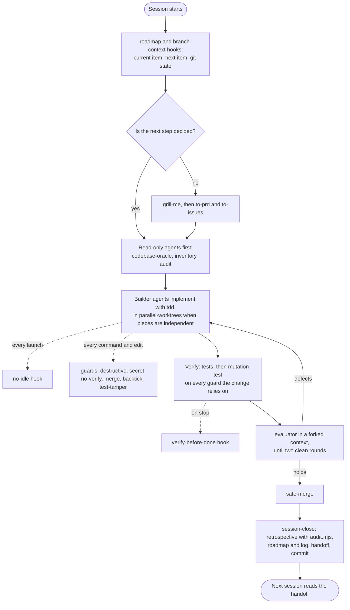

# pau-skills


The Claude Code skills, hooks and scripts I use every day, packaged as a plugin marketplace. I am Alvaro "Pau" Reis,
an AI engineer. They are for people who already use Claude Code on real projects and have noticed the same things I
have: agents report success when a file came out wrong, rules written in `CLAUDE.md` get broken anyway, and a session
that ends without a handoff costs the next one an hour.

Nothing here depends on a language or framework. The skills work in any repository, and the hooks are small Node.js
scripts with no dependencies and a test suite that proves each one can fail.

## Quick start

```bash
claude plugin marketplace add paureis/pau-skills
claude plugin install pau-skills@pau-skills
```

That installs everything. If your skills come from your claude.ai account instead (they then sync to the terminal,
the desktop app and the web), install only the hooks: `claude plugin install pau-skills-hooks@pau-skills`
([docs/INSTALL.md](docs/INSTALL.md) explains both). To take only part of it, install individual plugins instead (`session-discipline`,
`verification`, `agent-orchestration`, `guards`, `planning`), or copy a single skill's folder: every skill works on its
own, without the plugin or any other skill. For Codex, Cursor and other agents, the skills alone
install with `npx skills@latest add paureis/pau-skills`.

Not sure where to start? Run `/pau-skills:which-skill` and describe what you are doing.

[docs/INSTALL.md](docs/INSTALL.md) has every install, update and removal command.
[hooks/README.md](hooks/README.md) explains every hook and how to turn any of them off.

## What is where

```
skills/        every skill, one folder each, grouped by plugin
  session-discipline/   verification/   agent-orchestration/   guards/   planning/
hooks/         every hook script, grouped the same way, with the shared code in lib/
docs/          install guide, origins of each piece, the rules that are still sentences, how to add a skill
tests/         node:test suites for every script and hook (npm test)
scripts/       repository tooling: the marketplace builder, the skill scaffolder, the scrub check
.claude-plugin/marketplace.json   the plugin definitions Claude Code reads
```

## The idea

**A written rule that gets broken three times becomes a script, a hook or a gate.**

Most of what is here started as a sentence in a rules file. Each one was broken often enough, while it was already
written down, that I stopped rewriting the sentence and wrote code instead: a PreToolUse hook that blocks a shell
pattern, a harness that asserts the steps I kept getting wrong, a script that measures whether a new rule is just an
old one restated. The rules that are still sentences are in [docs/RULES.md](docs/RULES.md), and each one that has a
mechanism points to it. The `rule-to-hook` skill turns that habit into a process you can run on your own rules.

## Problems this fixes

### 1. "Done" when it is not done

The agent says the feature works. It never ran the tests, or the test it wrote cannot fail, or it made the suite
green by skipping the failing test.

- `verify-before-done` (hook) sends the agent back once if it changed code and ran no test, build or check afterwards.
- `test-tamper-guard` (hook) asks you before a test is skipped, focused or stripped of assertions.
- `tdd` builds one behaviour at a time, test first, and keeps a test only when it fails if the behaviour breaks and
  still passes after a pure refactor.
- `mutation-test` breaks the code on purpose to prove a test catches it, preferring a real past mistake from git
  history, and checks that a pure refactor leaves the test green.
- `evaluator` has a fresh agent, which did not build the change, grade it against its acceptance criteria.
- `verify-app` writes the project's own recipe for starting the real app and proving a change in it, with evidence.
- `bug-fix` finds the actual cause of a bug from runtime evidence and ships only the change that evidence justifies,
  when the cause is not obvious or a first fix did not hold.
- `hillclimb` makes a number better (run time, size, memory, a score) one measured change at a time, on a harness
  proven to notice a regression, and claims no win it did not measure.

### 2. Rules that are written down and still broken

`CLAUDE.md` grows by restating itself, and the rules that matter most are the ones broken under pressure.

- `rule-to-hook` turns a rule that keeps being broken into a tested check at the highest layer that holds it, often a
  hook, step by step, with a ratchet when the pattern is already common.
- `retrospective` turns a session's corrections into rule, memory or skill edits, gated by a script so nothing gets
  written twice.
- `instructions-audit` finds the size, duplicates, contradictions, stale references and vague rules in your instruction
  files.
- `agent-friendly-audit` mines review comments, fix commits, transcripts and instruction files for the mistakes agents
  repeat, and proposes a fix for each at the highest layer it can live in (architecture, types, a lint or CI check, a
  test, then prose), proven on a past instance.
- `skill-eval` checks whether a change to a skill or prompt changes what the agent actually does, with blind runs.

### 3. One command that cannot be undone

An agent that wants a clean slate reaches for `rm -rf`, `git reset --hard` or a force push, and the clean slate is
your work. An agent that wants a green commit reaches for `--no-verify`. An agent that wants a working demo pastes the
API key into the source.

- `destructive-guard` (hook) blocks deleting outside the project, force pushes to protected branches, discarding
  uncommitted work, `DROP DATABASE`, `terraform destroy` and similar.
- `secret-guard` (hook) blocks credentials being written into files.
- `no-verify-guard` (hook) blocks skipping git hooks and commit signing.
- `merge-guard` (hook) and `safe-merge` merge pull requests without closing the ones stacked on them.
- `inline-backtick-guard` (hook) blocks inline interpreter payloads that bash would silently rewrite.

### 4. Every session starts from zero

The new session does not know what the last one finished, which branch it is on, or what the user said before the
context was compacted.

- `roadmap` and `branch-context` (hooks) open every session with the current roadmap item and the git state.
- `compact-snapshot` (hook) saves your last messages, edited files and todo list before a compaction and hands them
  back after.
- `session-close` ends a session in a fixed order: retrospective, roadmap and log, handoff, commit.
- `handoff` writes a handoff the next session can resume from.

### 5. Building before the plan is decided

- `sharpen` restates a task in its own words, with the problem behind it and one outside check, and confirms before
  starting.
- `brainstorm` widens the options before `grill-me` narrows them, so the first idea is not the only one considered.
- `grill-me` interviews you one question at a time until every branch of the plan is decided.
- `to-prd` and `to-issues` turn the decided plan into a spec and vertical-slice issues.
- `codebase-oracle` answers questions about the code from the code and its history, and labels how strong the
  evidence is for each answer.
- `improve-codebase-architecture` finds refactors that make modules deeper and easier to test, and carries one out
  behind a characterization test when you ask.
- `architect` sketches the types and signatures in two different shapes before any code is written, and builds
  against the one that survives the red flags.

### 6. Several agents in one repository

- `parallel-worktrees` splits work into independent pieces, one git worktree and branch per agent, then integrates
  them one at a time.
- `methodology` is an operating method where no agent certifies its own work.
- `arena` runs several subagents at one task with different briefs, and a blind judge helps pick and combine the
  results.
- `lean-subagent-dev` is the light version for a whole session: one subagent at a time with a written brief, and the
  main session checks its work itself. It asks how much usage room you have and delegates less when it is tight,
  because a subagent costs more usage in total, not less. Every brief carries the same standing orders, and no
  subagent starts while a field of its brief is empty.
- `no-idle` (hook) stops subagents from ending their turn waiting for something that will never wake them.

### 7. A review that never ends

An AI review can always find one more thing, and each fix can bring a new bug, so the review and fix loop does not stop
by itself. Half the findings are preferences, and the fix for a minor one lands in the code where a mistake costs most.

- `review-triage` keeps only findings that name a failure, weighs the risk of each fix as well as the problem, and
  sorts them into must fix, fix if cheap, or leave. Every fix gets a test that fails without it, the second look covers
  only the fix, and there is one review round and one fix round. It works for any review, human or AI. When a review
  is only nits, it says the change is probably fine instead of asking for another round.
- `lean-subagent-dev` uses the same method for the review of each subagent's work.

### 8. The careful work nobody wants to do

- `dependency-upgrade` plans and applies upgrades in any ecosystem, one major version at a time, on a green baseline.
- `dependency-security-audit` gives a ranked vulnerability, reachability and supply-chain report for any ecosystem
  and for container images.
- `migration-review` checks a database migration for locks, downtime, data loss and a way back before it runs.
- `flaky-test-hunt` measures how often a test fails, finds the actual cause, and proves the fix.
- `ci-cost-and-cadence` decides how much CI to run and when, from measurements.

### 9. Starting with Claude Code for the first time

Someone who knows Claude from the browser opens Claude Code in their project and does not know what to ask, what it
will change, or how to make it remember how they like to work.

- `project-setup` reads the project, asks about ten short questions one at a time (Learn, Build or Mix; how much
  freedom Claude gets; what "done" means), shows the CLAUDE.md it wants to write, and writes nothing without a yes.
  It ends with a cheat sheet for the desktop app, terminal or editor, and a first small task. It works on its own,
  without the rest of this marketplace.

## What loads on its own

Every skill loads on its own: the agent can start it when your words fit its description ("let's brainstorm options
for this", "wrap up this session", "is this test any good"), and you can still type any of them as
`/pau-skills:<skill>` or `/<plugin>:<skill>`. Claude Code puts every description into the context of every session,
so each one is a short list of the phrases that should start it. `tests/context-budget.test.mjs` holds each
description to 400 characters and all of them to 12,000 together.

Some skills cost something when they run, and nothing else in them stops for your yes first: they launch subagents
or headless runs, commit, push or install with no other check, or change how the whole session works. When the agent
starts one of these on its own, without you asking for what it does, it first says in one or two lines what it will
do and what it will cost, and waits for your yes. A remark that only matches a description ("the code is getting
messy") does not count as asking.

- `arena`, `codebase-oracle` (big questions only), `parallel-worktrees`, `agent-friendly-audit`, `hillclimb`,
  `skill-eval`, `verify-app`;
- `dependency-upgrade`, `rule-to-hook`, `architect`, `session-close`;
- `lean-subagent-dev`, `methodology`.

`tests/confirm-step.test.mjs` keeps this list and the skills in step.
The other skills either cost little or already ask before they write (for example `retrospective` and `to-issues`
show you their edits or issues and wait).

## Reference

Every skill is a folder in [`skills/`](skills), grouped by plugin, and every hook is a script in [`hooks/`](hooks).
Each name below links to the file itself. A skill runs as `/<plugin>:<skill>`, or `/pau-skills:<skill>` from the
bundle. "Adapted" marks the skills
derived from [mattpocock/skills](https://github.com/mattpocock/skills) or from
[pstack](https://github.com/cursor/plugins/tree/main/pstack); everything else is original.

### session-discipline

- **[which-skill](skills/session-discipline/which-skill/SKILL.md)**: Recommends the skill or sequence of skills that fits your situation, and what
  to do about a run that went wrong.
- **[retrospective](skills/session-discipline/retrospective/SKILL.md)**: Turns a session's corrections into rule, memory or skill edits, gated by `audit.mjs`; drops
  an edit that would not change what a future agent does, and catches decisions that were right for the wrong reason;
  `--stale` finds rules that cite files that are gone.
- **[session-close](skills/session-discipline/session-close/SKILL.md)**: Closes a session in a fixed order: clean tree, retrospective, roadmap and log, handoff, commit
  and push.
- **[handoff](skills/session-discipline/handoff/SKILL.md)**: Writes a handoff the next session can resume from, after a retrospective gate.
- **[instructions-audit](skills/session-discipline/instructions-audit/SKILL.md)**: Audits CLAUDE.md, AGENTS.md and similar files, with `scan.mjs` for size, duplicates, stale
  references and secrets, and proposes edits for approval.
- **[project-setup](skills/session-discipline/project-setup/SKILL.md)**: Interviews you about how you want to work, then writes the project CLAUDE.md and,
  with a separate yes, your personal preferences, in your language. Written for people new to Claude Code.
- Hooks: [`roadmap`](hooks/session-discipline/roadmap.mjs), [`branch-context`](hooks/session-discipline/branch-context.mjs), [`compact-snapshot`](hooks/session-discipline/compact-snapshot.mjs).

### verification

- **[tdd](skills/verification/tdd/SKILL.md)** (adapted): Red-green-refactor in vertical slices, with mocking and refactoring rules, a
  two-edit check for which tests to keep, and "prefer no new test over a bad test" for small fixes.
- **[mutation-test](skills/verification/mutation-test/SKILL.md)**: `mutate.sh` applies one mutation (a real past fix reversed, when there
  is one) and checks by script that it applied, changed behaviour, and was restored; `--refactor` checks that a pure
  refactor leaves the test green.
- **[evaluator](skills/verification/evaluator/SKILL.md)**: A hostile evaluator in a forked context grades each contract assertion with reproducible evidence of
  the right kind for the change, marks a check that could not run as inconclusive, and names the patch its verdict
  covers.
- **[flaky-test-hunt](skills/verification/flaky-test-hunt/SKILL.md)**: Reproduces an intermittent failure with `repeat.mjs`, classifies the cause, and proves the
  fix with a measured failure rate.
- **[migration-review](skills/verification/migration-review/SKILL.md)**: Reviews a schema or data migration for locks, compatibility with running code, data safety
  and reversibility, for any migration tool.
- **[ci-cost-and-cadence](skills/verification/ci-cost-and-cadence/SKILL.md)**: Measures where CI minutes go, compares five options with numbers, and builds the chosen
  one.
- **[review-triage](skills/verification/review-triage/SKILL.md)** (adapted): Decides which review findings are worth fixing (must
  fix, fix if cheap, leave), with a test per fix and one review round and one fix round, says when a review is only
  nits, and records recurring findings as learned patterns; `review-scope.mjs` flags a fix with no test, in risky code
  or outside the change.
- **[bug-fix](skills/verification/bug-fix/SKILL.md)** (adapted): Reproduces a bug twice on the real surface, tests hypotheses with
  runtime evidence, fixes the first wrong decision instead of guarding the symptom, commits the failing repro before
  the fix, and proves what the change cannot break.
- **[verify-app](skills/verification/verify-app/SKILL.md)** (adapted): Generates a project skill, `.claude/skills/verify-<app>/`, that
  launches the real app, drives it like a user, keeps evidence that survives cleanup and cleans up only what it
  started, with a feature map; `check-map.mjs` checks it, and `maintain` keeps it in step with the app.
- **[hillclimb](skills/verification/hillclimb/SKILL.md)** (adapted): Improves one metric (time, size, memory, a score)
  step by step: a frozen harness proven sensitive with a deliberate regression, a stop predicate with a minimum number
  of attempts, one change and one measurement per attempt (keep or revert), a commit per win, and an append-only
  decision log outside the repository kept by `decisions.mjs`, with a checklist run before any number is reported.
- **[skill-eval](skills/verification/skill-eval/SKILL.md)** (adapted): Checks whether a change to a skill or prompt
  changes what an agent does: each variant runs several times as a headless `claude -p` session in a neutral folder
  that holds only that variant, runs are graded on what they did, and a reviewer with no tools scores them blind next
  to your own blind read; `skill-eval.mjs` sets up the folders, refuses leaks and makes the blind copy.
- Hooks: [`test-tamper-guard`](hooks/verification/test-tamper-guard.mjs), [`verify-before-done`](hooks/verification/verify-before-done.mjs).

### agent-orchestration

- **[methodology](skills/agent-orchestration/methodology/SKILL.md)**: Contracts, an evidence standard, an evaluator, convergence and two-file state, with templates.
- **[codebase-oracle](skills/agent-orchestration/codebase-oracle/SKILL.md)** (adapted): Answers questions about a codebase from the
  code and its history, grading each answer's evidence in five tiers, with read-only explorers for big questions;
  never presents a guess as a finding.
- **[parallel-worktrees](skills/agent-orchestration/parallel-worktrees/SKILL.md)**: Runs independent pieces of work in separate git worktrees, with `worktrees.mjs` to check a
  plan for overlapping files and report every worktree's state.
- **[lean-subagent-dev](skills/agent-orchestration/lean-subagent-dev/SKILL.md)** (adapted): A way of working for a whole session:
  one subagent at a time with a written brief and standing orders, the main session checks the work itself and triages
  the review, and the usage budget sets how much to delegate and each role's effort.
- **[arena](skills/agent-orchestration/arena/SKILL.md)** (adapted): Runs several candidate subagents at one task, each with a
  different brief, has a fresh judge score them blind against a rubric they never saw, then picks a base and grafts
  the best parts by hand; `arena.mjs` scaffolds the folders and makes the blind copy.
- Hook: [`no-idle`](hooks/agent-orchestration/no-idle.mjs).

### guards

- **[rule-to-hook](skills/guards/rule-to-hook/SKILL.md)** (adapted): Turns a rule that keeps being broken into a check at the
  highest layer that holds it (architecture, types, lint or CI with a ratchet, a test, or a hook for what the agent
  does), tested, proven on a past mistake and recorded in a rule table, with hook templates in JavaScript and Python
  and `ratchet.mjs` for patterns already common.
- **[safe-merge](skills/guards/safe-merge/SKILL.md)**: Merges a PR pinned to its head commit and deletes the branch only if no open PR is based on it;
  before merging on an older review or evaluator verdict, compares patch ids to see whether the verdict still holds.
- **[dependency-upgrade](skills/guards/dependency-upgrade/SKILL.md)**: Plans and applies dependency and toolchain upgrades in any ecosystem, step by step.
- **[dependency-security-audit](skills/guards/dependency-security-audit/SKILL.md)**: A ranked vulnerability, reachability and supply-chain audit for any ecosystem and
  container image, built on native audit tools and OSV-based scanners, not a raw scanner dump.
- Hooks: [`secret-guard`](hooks/guards/secret-guard.mjs), [`destructive-guard`](hooks/guards/destructive-guard.mjs), [`no-verify-guard`](hooks/guards/no-verify-guard.mjs), [`merge-guard`](hooks/guards/merge-guard.mjs), [`inline-backtick-guard`](hooks/guards/block-inline-backtick-payload.mjs).

### planning

- **[grill-me](skills/planning/grill-me/SKILL.md)** (adapted): Interviews you one question at a time until every branch of a plan is decided.
- **[to-prd](skills/planning/to-prd/SKILL.md)** (adapted): Synthesizes the conversation into a PRD without re-interviewing.
- **[to-issues](skills/planning/to-issues/SKILL.md)** (adapted): Splits a plan into vertical-slice issues for any tracker.
- **[improve-codebase-architecture](skills/planning/improve-codebase-architecture/SKILL.md)** (adapted): Finds refactors that turn shallow modules into deep ones,
  screened for red flags for agent contributors and for reader load, talks the chosen one through, and on request
  carries it out behind a characterization test, on its own branch.
- **[architect](skills/planning/architect/SKILL.md)** (adapted): Sketches types and signatures with not-implemented bodies before
  writing code, compares at least two shapes against red flags for agent contributors, then implements against the
  sketch test first and scraps it when deviations repeat.
- **[brainstorm](skills/planning/brainstorm/SKILL.md)**: Widens the options before a decision is settled: frames the
  goal in at most three questions, generates 10 to 20 options through named lenses, lets you keep, kill or combine
  them, then converges on 3 to 5 rated without a score, with a premortem each, and a one-page summary for `grill-me`.
- **[sharpen](skills/planning/sharpen/SKILL.md)** (adapted): Before a task, restates the goal and the problem behind
  it, asks how an expert would check the result, and confirms in six lines before working.
- **[agent-friendly-audit](skills/planning/agent-friendly-audit/SKILL.md)** (adapted): Mines review comments, fix and
  revert commits, this project's transcripts and instruction files for the mistakes agents repeat, and proposes a fix
  for each at the highest layer (architecture, types, lint, test, prose), proven on a past instance; `mine.mjs` does
  the read-only mining, with redaction. Writes nothing without your yes.

[docs/ORIGINS.md](docs/ORIGINS.md) records, for every piece, the problem that led to it and, for each adapted skill,
the upstream version it was compared against and what this version changes, taken from a diff.

### I also use, unmodified

My copies of these differ from upstream only by being shorter, so I do not republish them. Use the originals:

- [grill-with-docs](https://github.com/mattpocock/skills/tree/main/skills/engineering/grill-with-docs) by Matt Pocock
- [prototype](https://github.com/mattpocock/skills/tree/main/skills/engineering/prototype) by Matt Pocock

## How the pieces fit into a session



## How I use these day to day

A session starts with the roadmap and git summary in context, and with the handoff from the last session if there is
one. I work one roadmap item at a time. Before anything is built, read-only agents report on what already exists and
what the change will touch; the design discussion starts from their reports, not the other way round. When the plan
has open decisions, `grill-me` settles them one question at a time.

Implementation goes to subagents. The no-idle hook means I no longer have to remember to tell each one not to sit
waiting on a background task, and the guards stop the shell mistakes I made most often. Nothing counts as done
because a builder said so: each guard gets a mutation run through `mutate.sh`, and an evaluator that has not seen the
build attacks it.

When the work is done or the context is running out, `session-close` runs the retrospective (whose audit usually tells
me the lesson is already written somewhere, and the fix is a hook rather than another sentence), updates the roadmap
and the log, writes the handoff, and commits.

## Development

```bash
npm test                          # node --test, no dependencies
npm run scrub                     # fails on private names, account ids, machine paths or untranslated text
node scripts/build-marketplace.mjs  # regenerate marketplace.json after changing a hooks.json or a plugin folder
claude plugin validate . --strict # the marketplace; add a plugin path to check one plugin
npm run pack-skills -- <skill>    # dist/<skill>.zip for upload to claude.ai; --since <ref> or --all
```

To bring a new skill into the repository, start with `node scripts/new-skill.mjs <plugin> <skill-name>` and follow
[docs/ADDING-A-SKILL.md](docs/ADDING-A-SKILL.md).

## Credits

- The planning skills and `tdd` are adapted from [mattpocock/skills](https://github.com/mattpocock/skills) by Matt
  Pocock, under the MIT License. The upstream notice is in [NOTICE](NOTICE). The layout of this README, organised
  around the problems each piece fixes, also follows his.
- `arena`, `architect`, `bug-fix`, `verify-app`, `hillclimb`, `skill-eval`, `agent-friendly-audit`, `sharpen`,
  `codebase-oracle` and `rule-to-hook` are adapted from [pstack](https://github.com/cursor/plugins/tree/main/pstack)
  by Lauren Tan, under the MIT License, and `tdd`, `review-triage` and `lean-subagent-dev` take parts of their text
  from it. The upstream notice is in [NOTICE](NOTICE). The context budget and several
  rules in [docs/BACKLOG.md](docs/BACKLOG.md) also come from reading it.
- Everything else is mine, under the MIT License ([LICENSE](LICENSE)).
