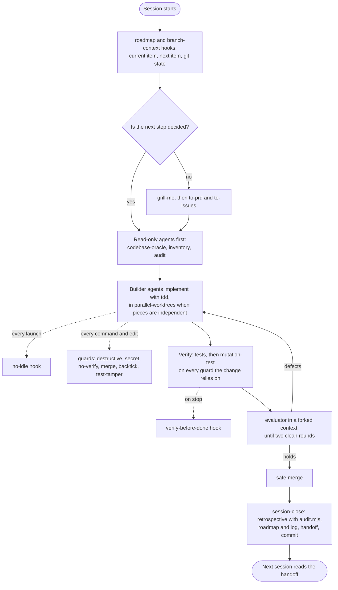

# Workflow

Back to the [README](../README.md).

## How the pieces fit into a session

## How I use these day to day

A session starts with the roadmap and git summary in context, and with the handoff from the last session if there is
one. I work one roadmap item at a time. Before anything is built, read-only agents report on what already exists and
what the change will touch; the design discussion starts from their reports, not the other way round. When the plan
has open decisions, `grill-me` settles them one question at a time.

Implementation goes to subagents. The no-idle hook means I no longer have to remember to tell each one not to sit
waiting on a background task, and the guards stop the shell mistakes I made most often. Nothing counts as done
because a builder said so: each guard gets a mutation run through `mutate.sh`, and an evaluator that has not seen the
build attacks it.

When the work is done or the context is running out, `session-close` runs the retrospective (whose audit usually tells
me the lesson is already written somewhere, and the fix is a hook rather than another sentence), updates the roadmap
and the log, writes the handoff, and commits.
